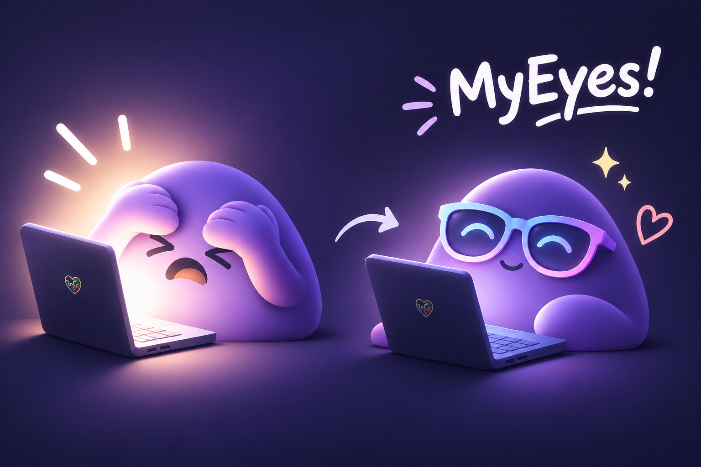
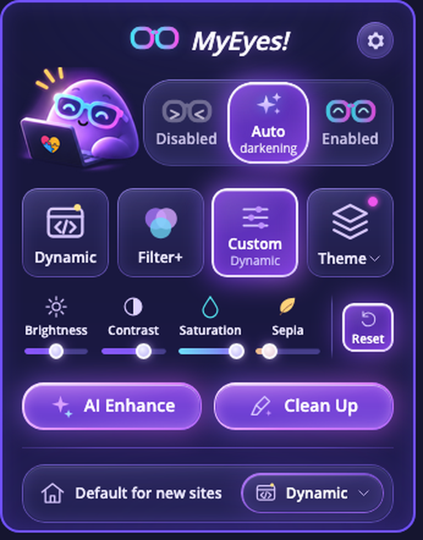
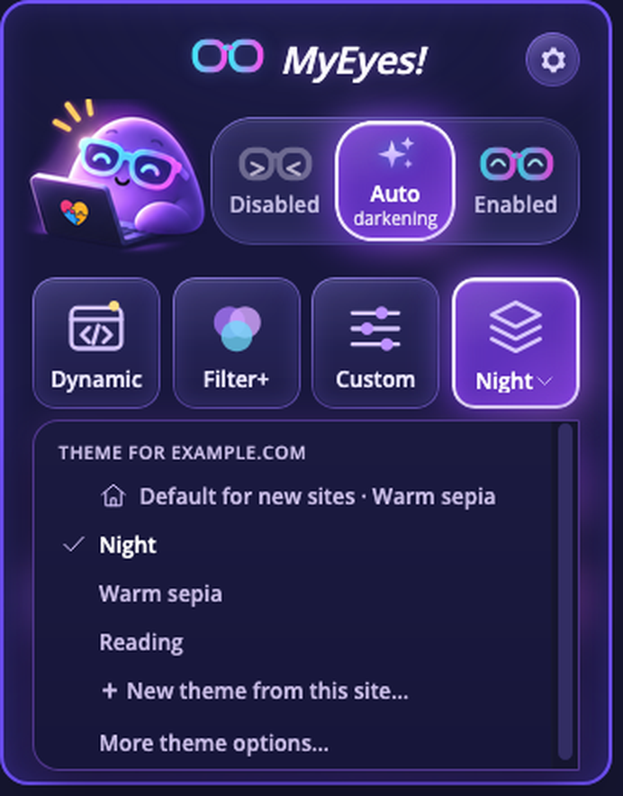
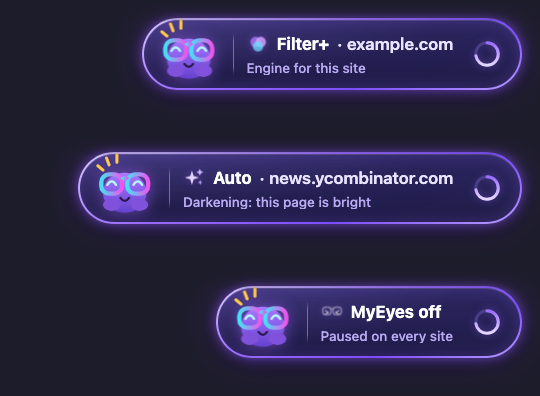

<h1 align="center">MyEyes!</h1>

<strong>Accessibility-first dark mode for every website.</strong> Dark by default, so bright pages never catch you off guard.

---

**MyEyes!** is an open-source (MIT) browser extension that turns any site dark — proactively, keyboard-driven, and easy on photophobic eyes. It's a rebranded fork of [Dark Reader](https://github.com/darkreader/darkreader): it keeps Dark Reader's proven dynamic-theme engine and its community-maintained per-site fixes (fetched and cached at runtime), wrapped in a deliberately small, calm UI: one pane, no tabs, no wall of sliders.

  
  &nbsp;
  
  &nbsp;
  

## Features

**Dark by default**

- 🌙 Proactive dark mode for every website, using Dark Reader's dynamic engine, or **Filter+** (a simpler, filter-based engine) when you prefer it.
- 🔄 Community per-site fixes, fetched and cached from upstream at runtime, with a bundled offline fallback, so popular sites keep looking right.
- 🖼️ **Tames bright images** (on by default): diagrams and charts on white backgrounds are inverted so they sit dark like the page, bright photos are dimmed (never inverted: a negative photo is worse), and black logos on transparent backgrounds stay visible. Under Filter+ the engine's own image filter handles photos. There's no switch for it in the UI yet.

**One pane, per site**

- **Disabled · Auto · Enabled** for the current site. *Auto* (every site's default) darkens a page unless it's already dark, *Enabled* always darkens it, *Disabled* leaves it alone.
- **Dynamic · Filter+ · Custom · Theme** cards show where the site's look comes from, with **Brightness, Contrast, Saturation and Sepia** sliders under them.
- **Named, reusable themes.** Move a slider and the site quietly forks its theme (a pink dot marks unsaved changes). *Save*, *Save as…* or *Revert* from the Theme menu, pin any saved theme to any site, or make one the **Default for new sites**.
- **Tweaks aren't lost by accident.** Switching cards or themes parks a site's own settings, and the Custom card brings them back. **Reset** (two clicks) drops them for good.

**Keyboard-first**

| Shortcut | Does |
| --- | --- |
| `Alt+Shift+A` | Toggle darkening for this site |
| `Alt+Shift+T` | Next theme for this site: Dynamic → Filter+ → Custom (if the site has tweaks) → each saved theme → … |
| *unbound* | Turn MyEyes! on or off everywhere |
| *unbound* | Next default theme for new sites |

(`Alt` is `Option` on macOS.) Rebind or add the two unbound ones in the extension's Hotkeys options, in Firefox at `about:addons` → ⚙ → *Manage Extension Shortcuts*, or in Chrome at `chrome://extensions/shortcuts`.

**Built for sensitive eyes**

- Every shortcut answers with a small **on-screen confirmation**: what changed, and on which site. It's click-through, never takes focus, honors *reduce motion*, and **stays dark even on pages a filter engine inverts**, so the confirmation itself can't flash you.

  

  

## Roadmap

- **Community userstyles** (UserStyles.world / USO-archive) as a second per-site source next to Dark Reader's fixes. A UserCSS reader that sanitizes untrusted community CSS is in the tree; fetching, caching and per-site resolution are next.
- **AI-enhanced page adaptation using local, on-device models** (declutter, improve readability; nothing leaves your machine). *AI Enhance* and *Clean Up* are placeholders in the popup until this lands. A render metric that scores glare against retained page structure is in the tree to judge the results: models advise, pixels decide.

## Contribute 💜

Setup, the build and the dev loop, hard-won tips, and how to open a pull request all live in **[CONTRIBUTE.md](CONTRIBUTE.md)**. You don't need to be a hacker to help (translations, bug reports and feedback count).

> **Easiest start:** open [Claude Code](https://claude.com/claude-code), OpenAI Codex or any coding agent in this folder and say *"Read CONTRIBUTE.md and get me set up to hack on MyEyes!"* It will take it from there.

## Credits

Forked from [Dark Reader](https://github.com/darkreader/darkreader) (© Dark Reader Ltd., MIT) — the upstream `LICENSE` is preserved; see [FORK.md](FORK.md) for provenance.

MIT © Carlos Cabrera
