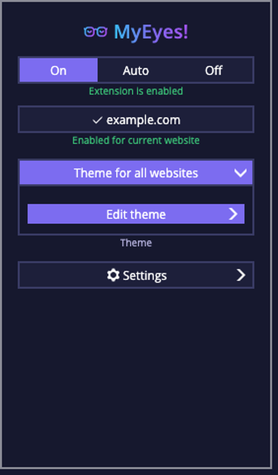
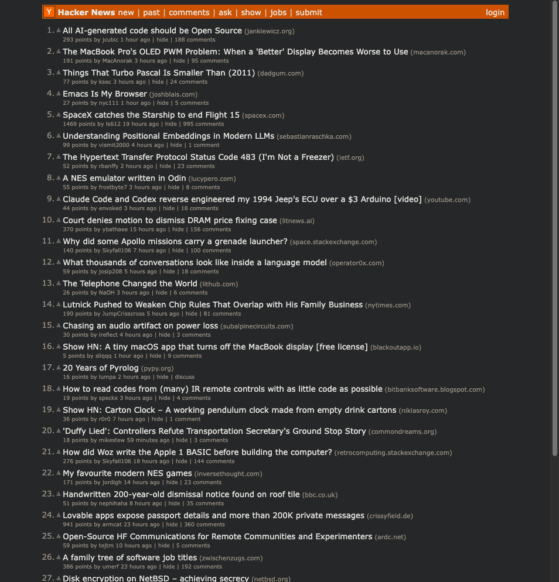

<p align="center"></p>

<h1 align="center">MyEyes!</h1>

<p align="center"><strong>Accessibility-first dark mode for every website.</strong><br/>Dark by default, so bright pages never catch you off guard.</p>

---

**MyEyes!** is an open-source (MIT) browser extension that turns any site dark — proactively, keyboard-driven, and easy on photophobic eyes. It's a rebranded fork of [Dark Reader](https://github.com/darkreader/darkreader): it keeps Dark Reader's proven dynamic-theme engine and its community-maintained per-site fixes (fetched and cached at runtime), wrapped in a deliberately minimal UI.

## Features

- 🌙 Proactive dark mode for every website — Dark Reader's dynamic engine
- 🔄 Community per-site fixes, fetched & cached from upstream at runtime
- 🧩 Minimal, keyboard-first UI — no tabs, no clutter

**Roadmap:** named reusable themes · keyboard commands for all toggles · community userstyles (UserStyles.world / USO) · AI-enhanced page adaptation using **local, on-device models** (declutter, improve readability — nothing leaves your machine).

## Screenshots

<p align="center">
  
  &nbsp;&nbsp;
  
</p>

## Build

Requires [Node.js](https://nodejs.org/) (LTS+).

```sh
npm install
npm run build      # release build -> build/release/
npm run debug      # unpacked build -> build/debug/<browser>/
```

Load `build/debug/firefox` via `about:debugging` → *Load Temporary Add-on*.

## Credits

Forked from [Dark Reader](https://github.com/darkreader/darkreader) (© Dark Reader Ltd., MIT) — the upstream `LICENSE` is preserved; see [FORK.md](FORK.md) for provenance.

MIT © Carlos Cabrera
